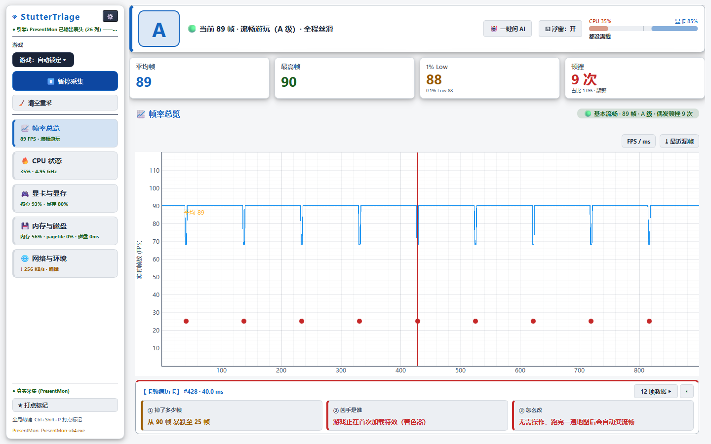
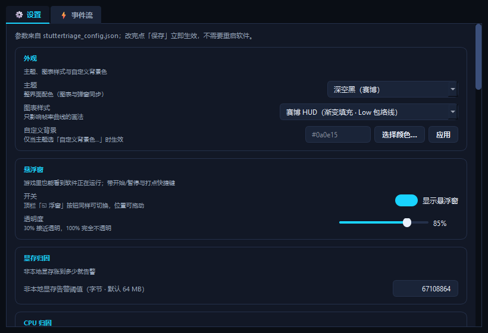
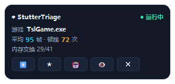

# StutterTriage

**Windows 游戏卡顿（掉帧）一站式体检台**
把「帧率掉了」翻译成一句人话，再给你一招解决建议。




<details>
<summary>更多截图（设置页 / 悬浮窗）</summary>

| 设置页（深色） | 悬浮窗 |
| --- | --- |
|  |  |

</details>

## 下载

前往 [Releases](https://github.com/munchroot/StutterTriage/releases/latest) 下载 `StutterTriage.exe`，单文件、免安装。
建议右键 → **以管理员身份运行**，才能获得完整采集能力。

### 系统要求

- Windows 10 1709+ / Windows 11（x64）。不支持其它平台。
- 显卡驱动正常安装（AMD ADL / NVIDIA NVML 用于频率与显存读数，读不到时对应行标注「不可判定」）。
- 无需安装 PresentMon：Intel 官方 2.6.0 已内置在 EXE 里（见 [THIRD_PARTY.md](THIRD_PARTY.md)）。
- 免安装、不写注册表；配置写在 exe 同目录，运行日志写在 `%USERPROFILE%\.stuttertriage\`。

### 首次采集（三步）

1. **右键 exe → 以管理员身份运行**，点左侧「▶ 开始采集」。
2. 切回游戏，复现你感觉卡的那 10~30 秒（切屏/加载卡顿也一并录进去）。
3. 回到 StutterTriage：看横幅那一句人话结论；点「🤖 一键问 AI」导出 CSV + 专家提示词，
   交给 ChatGPT / DeepSeek / Kimi 做根因排序。

> 没有游戏在画时只会显示硬件心跳，不会画出假曲线；全屏独占游戏（如 GTA5）常以
> `<unknown>` 上报，在左侧「游戏」菜单里手动添加它即可。

## 功能亮点

- **帧时间体检**：FPS、1% Low、0.1% Low、帧耗时 P99，实时曲线可缩放
- **卡顿归因**：把尖峰拆成 12 个维度（显存溢出、CPU 单核拥堵、降频、着色器编译、内存交换、磁盘排队等），给出一句话结论和一招建议
- **内存-磁盘交换证据链**：用页面文件、硬缺页、磁盘延迟、DWM 占用互相印证，明确回答「这次卡顿是不是内存交换」
- **一键问 AI**：导出体检数据（CSV）并生成可直接复制的提示词，交给 ChatGPT / DeepSeek / Kimi 做根因分析
- **悬浮窗与多选游戏**：游戏内置顶显示状态，可同时选择多个进程，全屏独占游戏也能手动添加
- **多套皮肤**：浅色、深色、深空、HUD、CapFrameX，支持热切换

## 从源码运行

```bash
python -m pip install -r requirements.txt
python StutterTriage.py
```

需要 Windows 10 1709+ 或 Windows 11。PresentMon 已内置，克隆后即可使用。

跑测试（本地与 CI 共用同一个入口）：

```powershell
pwsh -File scripts\test.ps1              # 普通离线回归（core）
pwsh -File scripts\test.ps1 -Suite all   # 加上真实 ETW 用例与预览图渲染
```

## 已知限制

- 仅支持 Windows。找不到 PresentMon 或采集起不来时，程序会**明确标注**切到「模拟数据流」
  （图表打水印、侧栏写数据源），不会冒充真实采样；真实采集需要完整的 ETW 权限。
- 系统计数器采样粒度粗于几十毫秒的尖峰，交换证据给出的是「会话级重合率」和置信度，需要事件级精度请使用 Microsoft PIX。
- 项目使用 PyQt6（GPL-3.0 / 商业双许可）。若要用于闭源商业软件，请改用 PySide6 或购买 PyQt 商业许可。
- 其余口径（1% Low、最高帧、坐标轴锁轴、EXE 强杀残留等）见 [开发笔记](docs/NOTES.md)。

## 文档

- [更新日志](CHANGELOG.md)
- [开发与打包指南](docs/DEVELOPMENT.md)（目录结构 / 测试入口 / 构建与发布）
- [参与贡献](CONTRIBUTING.md)
- [开发笔记与已知限制](docs/NOTES.md)
- [内存交换与 perfmon 对齐说明](docs/UPGRADE_1.1.0.md)
- [第三方组件与许可](THIRD_PARTY.md)

## 许可与致谢

本项目以 [MIT](LICENSE) 发布，由 **大肥鱼** 开发。
随包分发的 PresentMon 为 Intel 官方发行版（MIT），详见 [THIRD_PARTY.md](THIRD_PARTY.md)。
